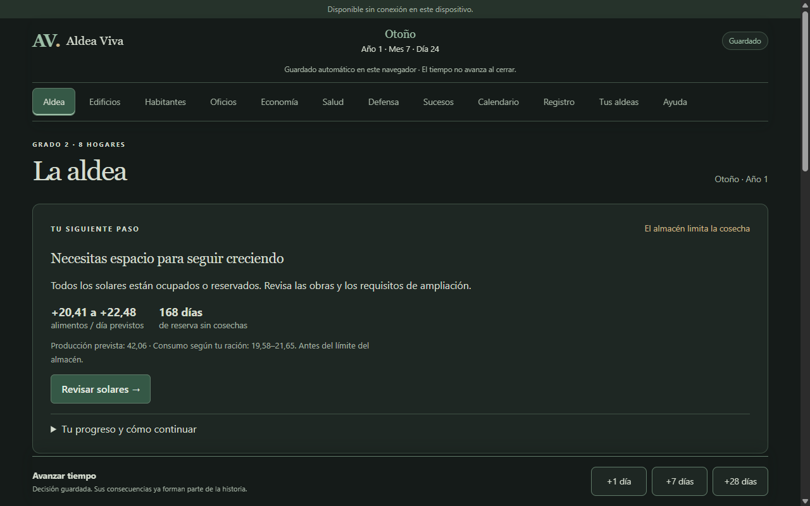

# Aldea Viva — Informe de jugabilidad y pruebas

**Seguimiento:** este diagnóstico se conserva como histórico. Los arreglos y verificaciones posteriores están en [Primer año — rc.3](19_PRIMER_ANO_RC3.md).

**Fecha:** 3 de noviembre de 2026.  
**Versión examinada:** `1.0.0-rc.2` con la guía contextual y las propuestas de oficios locales, todavía sin publicar.  
**Entorno:** Brave de automatización aislado, escritorio de 1280×800 y móvil horizontal de 844×390. Aplicación local en el puerto 4176. No se utilizaron partidas del usuario.

## Dictamen

El juego tiene un motor funcional y sus sistemas principales se relacionan: los oficios producen, las obras consumen materiales y tiempo, las reservas sostienen la supervivencia y los sucesos modifican personas y edificios. Se puede sobrevivir al primer invierno.

La dificultad más importante es aprender a planificar. Resulta fácil confundir «la comida crece hoy» con «estoy preparado para el invierno». Una decisión aparentemente razonable, como mantener la tala trabajando, puede acabar ocupando el espacio necesario para las cosechas. La nueva guía ayuda mucho en los primeros días, pero también produce consejos equivocados y puede agotar los solares persiguiendo más almacenes.

**La prioridad es mejorar orientación, planificación de reservas y recuperación de errores.** El ciclo necesita hacer visibles las causas, los objetivos y los logros. En esta revisión no se han cambiado reglas, equilibrio ni interfaz para corregir los hallazgos.

## 1. Qué se ha probado realmente

| Trabajo | Alcance realizado |
|---|---|
| Partidas en navegador | Tres partidas en las tres ranuras, mediante controles de la interfaz y automatización de navegador |
| Primera partida | Un año completo: 336 días transcurridos, hasta primavera del año 2 |
| Segunda partida | Hasta la extinción de sus 16 habitantes: 328 días transcurridos |
| Tercera partida | Seis días transcurridos para probar obras, cancelación, destinos exclusivos y vivienda nueva |
| Comparación del motor | Once recorridos con órdenes públicas; siete hasta un año o extinción y cuatro hasta dos años o extinción |
| Generación inicial | 64 semillas consecutivas: `analisis-inicio-0` a `analisis-inicio-63` |
| Regresión existente | **287 pruebas aprobadas en 23 archivos**, excluyendo la antigua integración larga |
| Comprobaciones adicionales | Comparación de estrategias, repetición de órdenes/recarga y escenario controlado de víspera del invierno |
| Persistencia | Recarga y recuperación sin conexión de las tres ranuras, manteniendo sus estados independientes |

Las simulaciones del motor no son partidas pulsadas en el navegador. Usan generación, asignación, construcción, mantenimiento, avance, decisiones y serialización existentes. No se regalaron recursos ni se alteraron fórmulas en esos once recorridos.

Hay una excepción expresamente identificada: para aislar un consejo estacional se construyó una variante de presentación sin heridas a partir de un estado del día 251. Ese escenario controlado no se cuenta como supervivencia lograda.

Las estrategias aplican políticas sencillas; sus resultados son ejemplos reproducibles, no una clasificación definitiva de estrategias. Compartir semilla inicial no conserva idéntica secuencia de sucesos cuando cambian las decisiones y las extracciones de azar. No se probaron físicamente Android, instalación como APK, todos los tamaños de pantalla ni todas las combinaciones posibles de eventos.

## 2. Diario de las tres partidas de navegador

### Partida 1 — Aprender siguiendo la guía

**Semilla:** `opinion-jugador-2026-11-02`. **Inicio:** 20 habitantes, 184 alimentos, 99 de madera.

1. Revisé y apliqué la propuesta de oficios. Los cuatro agricultores iniciales seguían sin cubrir el consumo previsto.
2. Preparé el tercer huerto con el acceso directo de la guía. Los constructores lo terminaron tras tres avances de un día.
3. Apliqué una segunda propuesta para ocupar sus dos puestos nuevos. La previsión pasó a ser positiva.
4. Construí almacenes cuando la guía avisó de falta de espacio y amplié al grado 2.
5. Elegí intentos prudentes en oportunidades y negocié los asaltos cuando fue posible. Rechacé visitantes en esta partida.
6. Llegué a **cuatro casas, tres huertos y siete almacenes**: los catorce solares estaban ocupados.
7. En otoño, la guía seguía enviándome a revisar solares y requisitos de ampliación. Ya había alcanzado el grado máximo disponible. Para continuar tuve que seguir avanzando sin completar ese consejo.
8. Atravesé el invierno usando las reservas acumuladas y llegué a **año 2, mes 1, día 1**.

**Resultado:** 20 vivos, ningún fallecido, **1.264,51 alimentos** y **1.240,92 de madera**. Una persona necesitaba atención; una casa había recibido daños y estaba aproximadamente al 62 % de conservación. Sobrevivir no significó que todas las necesidades estuvieran resueltas.

**Lectura:** la guía permite aprender el circuito básico, pero todavía confunde una respuesta local —más capacidad— con un plan de aldea a medio plazo. No era necesario presentar como objetivo inmediato seguir creciendo cuando ya había reservas muy amplias.

### Partida 2 — Aplicar oficios y confiarse

**Semilla:** `analisis-inicio-7`. **Inicio:** 16 habitantes, 192 alimentos, 89 de madera.

- Apliqué la propuesta una vez. La previsión inicial resultó positiva: producción de 16,95 frente a consumo de 15,04–16,62.
- Trasladé a Diego del Prado de Casa 1 a Casa 4. Conservó familia, pareja y descendientes; la nueva vivienda quedó señalada como decisión del jugador.
- Busqué `DIEGO` y obtuve un único resultado. Consulté dos meses futuros del calendario sin cambiar el día real.
- Probé ración de emergencia, prioridad a menores y madera primero durante siete días; después restablecí la política normal. La comida aumentó y la guía advirtió correctamente que comer menos acumula hambre.
- Continué con los edificios iniciales. Rechacé oportunidades y visitantes y resolví asaltos. No amplié el almacenamiento.
- Llegué a la extinción en **año 1, mes 12, día 21**: 328 días transcurridos.

**Resultado:** 0 vivos, 16 fallecidos, **0 alimentos y 427,75 de madera**. La crónica conservó 328 días de historia, tres asaltos resueltos y seis descubrimientos de aptitudes.

**Lectura:** un comienzo con excedente puede terminar mal aunque no se cambien los agricultores. El aprendizaje pendiente es conservar comida de verano para el invierno y controlar la ocupación del almacén. Esta partida incluye siete días de racionamiento experimental: no debe confundirse con las simulaciones de «solo propuesta», que mantuvieron su política normal.

### Partida 3 — Construcción y control manual

**Semilla:** `analisis-inicio-14`. **Inicio:** 15 habitantes, 213 alimentos, 92 de madera.

- Preparé un huerto, lo pausé, reanudé y cancelé antes de empezar. Volví a disponer de las 92 unidades de madera.
- Preparé otro, nombré constructores y fijé uno de ellos exclusivamente a esa obra.
- Al avanzar, se consumieron los 20 materiales y apareció progreso de **15/40**.
- Pausé y avancé un día: el progreso permaneció en **15/40**.
- Cancelé después de empezar. Se liberó el solar y la madera consumida no se devolvió; el texto del botón lo advertía.
- El constructor exclusivo quedó con destino en conflicto. La propuesta no lo movió por su cuenta. Lo devolví manualmente al reparto flexible.
- Construí una quinta casa; quedó vacía, con cinco plazas, conservando las asignaciones anteriores.
- Autoricé mantenimiento y configuré una reserva mínima de 50 de madera.

**Resultado:** 15 vivos en el día 7 del primer mes. Las reglas de obra y las órdenes manuales se respetaron. El problema aquí es de comunicación: «tener oficio» no implica que una persona esté trabajando o que su destino siga disponible.

Al recargar sin conexión, las tres ranuras conservaron estas situaciones; la primera siguió en primavera del año 2.

## 3. Comparación de once recorridos del motor

**A:** `opinion-jugador-2026-11-02`, población inicial 20.  
**B:** `analisis-inicio-7`, población inicial 16.  
Los días de esta tabla son **días transcurridos**, con fundación en 0. Cada año tiene 336 días.

| Política | Semilla | Días | Vivos finales | Comida final | Madera final | Capacidad final |
|---|---|---:|---:|---:|---:|---:|
| Asistida por guía | A | 336 | 20 | 1.293,63 | 1.200,08 | 4.200 |
| Solo propuesta inicial | A | 310 | 0 | 0 | 599,75 | 600 |
| Asistida por guía | B | 336 | 16 | 2.153,39 | 1.387,68 | 4.800 |
| Solo propuesta inicial | B | 323 | 0 | 0 | 450,39 | 600 |
| Ningún oficio inicial | A | 63 | 0 | 0 | 98,01 | 600 |
| Tala excesiva | A | 293 | 0 | 0 | 599,75 | 600 |
| Asistida, decisiones arriesgadas | B | 336 | 18 | 719,83 | 1.421,45 | 3.600 |
| Gestión activa: seis agricultores | A | 355 | 0 | 0 | 128,51 | 1.800 |
| Gestión activa: ocho agricultores | A | 672 | 20 | 1,39 | 192,32 | 1.800 |
| Gestión activa: seis agricultores | B | 672 | 16 | 387,64 | 188,90 | 1.800 |
| Gestión activa: ocho agricultores | B | 672 | 19 | 258,04 | 191,68 | 1.800 |

**Qué significa cada política:**

- **Asistida por guía:** aplica propuestas y obras sugeridas; responde decisiones, amplía cuando procede y sigue avanzando. El adaptador también puede autorizar mantenimiento, usar ración abundante ante atención sanitaria y continuar aunque un consejo de solares no tenga salida. No demuestra que obedecer exclusivamente cada botón de la guía sea suficiente.
- **Solo propuesta:** un único reparto, sin construir ni volver a repartir; se resuelven decisiones pendientes para que el tiempo continúe.
- **Abandono:** ningún oficio ni construcción; se resuelven los bloqueos de decisiones. No es una simulación de cerrar la aplicación: cerrada, la aldea no avanza.
- **Tala excesiva:** propuesta inicial y asignación de habitantes elegibles que quedan libres a tala, sin construir almacenes.
- **Arriesgada:** gestión asistida, opciones audaces y salidas ofensivas cuando están disponibles. Terminó con dos personas adicionales por una llegada aceptada; una sola partida no demuestra que arriesgar sea mejor.
- **Gestión activa:** jugador sintético existente, con mantenimiento autorizado, madera regulada, ampliación y hasta 1.800 plazas. La variante de seis agricultores intenta tres huertos; la de ocho, cuatro. No es un jugador óptimo y esas cantidades no garantizan sobrevivir.

Un caso importante: los veinte supervivientes de la variante A con ocho agricultores terminaron el segundo año con **hambre media 75,94 y salud media 87,13**. Contar supervivientes no basta para declarar una estrategia estable.

Las partidas registraron oportunidades agrícolas, rutas de bosque, ataques, descubrimientos y, en algunas, visitantes aceptados. Las cuatro gestiones largas y los recorridos cortos guardaron/releyeron estados mediante el formato existente.

## 4. Problemas y mejoras, por prioridad

**P1:** afecta a decisiones esenciales o puede conducir a una mala planificación. **P2:** perjudica claridad, ritmo o variedad. **P3:** pulido. La prioridad no convierte una observación de diseño en un fallo del motor.

| ID | Prioridad | Clasificación | Hallazgo |
|---|---|---|---|
| AV-JUG-001 | P1 | Error de orientación, reproducido en UI | Recomienda revisar ampliación con grado 2 y catorce solares ya ocupados |
| AV-JUG-002 | P1 | Planificación deficiente, UI y motor | La respuesta repetida al almacén lleno es construir más, sin objetivo suficiente de reservas ni alternativa de regular tala |
| AV-JUG-003 | P1 | Consejo estacional, escenario controlado | En víspera del invierno puede recomendar otro huerto para corregir la caída estacional de mañana |
| AV-JUG-004 | P1 | Dificultad inicial, muestra de semillas | El reparto inicial no garantiza cubrir consumo; la dificultad cambia mucho entre aldeas |
| AV-JUG-005 | P1 | Información estratégica insuficiente | Falta una previsión clara de si la comida almacenada alcanza para el invierno |
| AV-JUG-006 | P2 | Error de presentación, UI | Tras la extinción aparece «La comida puede crecer» |
| AV-JUG-007 | P2 | Estado laboral poco visible, UI | El total «con oficio» incluye personas con destino en conflicto |
| AV-JUG-008 | P2 | Ritmo, partidas y reglas | Oportunidades repetitivas interrumpen con frecuencia avances largos |
| AV-JUG-009 | P2 | Equilibrio a investigar | Negociar resulta una opción muy cómoda cuando sobran recursos |
| AV-JUG-010 | P2 | Progresión, muestra y código | Grado 2 disponible desde la fundación en las 64 semillas examinadas |
| AV-JUG-011 | P2 | Identidad y ergonomía, observación UI | Mucha administración simultánea y poca síntesis de la historia de la comunidad |
| AV-JUG-012 | P3 | Textos de estado, UI | Una aldea extinguida sigue titulándose «Una historia en marcha» en su ranura |

### AV-JUG-001 y 002 — Crecer sin saber cuándo basta

**Reproducción de UI:** partida A, año 1/mes 7/día 24, grado 2. Cuatro casas, tres huertos, siete almacenes y cero solares libres. Había **3.649,46 alimentos, 526,84 de madera y 168 días de reserva sin cosechas**. La guía indicaba «Necesitas espacio para seguir creciendo» y remitía a los requisitos de ampliación. La pantalla de edificios solo ofrecía «Grado 2 alcanzado».

**Causa en código:** `selectGuidance`, en `src/game/selectors/guidance.ts`, deriva la falta de capacidad hacia solares/ampliación sin comprobar que se haya alcanzado el límite de grado. La propuesta de oficios conserva la tala ya asignada; el umbral para nombrar un leñador no constituye una orden de detenerlo al alcanzarlo.

**Consecuencia:** no hay bloqueo técnico del avance, pero la ayuda entra en un callejón sin salida. El jugador puede gastar todos los solares siguiendo instrucciones y perder margen para una quinta casa o cambios de producción. Recibir visitantes sigue siendo posible, pero los que no quepan pueden quedar sin vivienda.

**Mejora:** reconocer explícitamente el límite; dejar de insistir en ampliaciones inexistentes; explicar cuándo las reservas ya cubren el objetivo previsto. Proponer revisar la tala o los puestos actuales con confirmación del jugador, manteniendo protegidas sus órdenes. La guía debería ayudar a reservar espacio para decisiones futuras.

### AV-JUG-003 — Un huerto no resuelve la llegada del invierno

Se aisló el día transcurrido 251, último día de otoño, con tres huertos, diez edificios y catorce solares. En la variante controlada sin heridas, la guía recomienda **«Construye otro huerto»** porque la producción prevista de mañana ya utiliza el factor de invierno. El consejo comprueba si la estación actual es invierno, mientras la previsión corresponde al día siguiente.

Es un fallo de orientación confirmado mediante el selector, no una partida natural sin heridas. En el estado natural de ese ensayo, una necesidad sanitaria tenía prioridad y ocultaba ese consejo.

**Mejora:** considerar la estación prevista, el tiempo necesario para construir y el efecto real esperado antes de recomendar una obra. En esa situación la pregunta principal es cuánta comida falta para atravesar el invierno. Datos completos en `informe-jugabilidad-2026-11-03/vispera-invierno-controlado.json`.

### AV-JUG-004 y 005 — Producción diaria y preparación invernal son problemas diferentes

En las 64 aldeas iniciales, tras la propuesta:

- **13** producían menos incluso que el mínimo de consumo previsto.
- **20** producían dentro del intervalo de consumo: su margen era incierto.
- **31** cubrían el máximo previsto.

Por tanto, **33 de 64 no cubrían el extremo superior del intervalo**. Ese dato no significa que las 33 fueran a perder comida todos los días. Tampoco es una estimación representativa de todos los jugadores: es una muestra determinista de semillas especificadas.

La presión por construir pronto puede ser una regla válida. Lo que necesita mejorar es su explicación y el margen para aprender. Para veinte personas, llenar los dos huertos puede resultar insuficiente; para quince o dieciséis, el mismo paso puede parecer que ha resuelto el problema.

La dificultad reaparece en invierno: la variante de gestión activa con veinte personas y ocho agricultores rechazó **17.352,11 alimentos por falta de espacio durante dos años**, y acabó con 1,39 alimentos y hambre elevada. Producir mucho durante el verano no compensa no poder conservarlo.

**Mejora:** un resumen de preparación estacional: días hasta invierno, reserva aproximada necesaria, reserva actual, capacidad disponible y déficit estimado. Debe indicar sus supuestos, usar necesidades alimentarias adecuadas y evitar prometer que una previsión es garantía. Las raciones reducidas no deben presentarse como solución nutritiva permanente.

### AV-JUG-006 y 012 — El final necesita su propio lenguaje

La partida de navegador 2 acabó con todos muertos. El título principal reconocía el final, pero el indicador superior mantenía **«La comida puede crecer»**, con un balance de 0 a 0. En la ranura seguía figurando **«Una historia en marcha»**, aunque el botón ya decía «Consultar historia».

**Causa localizada:** el texto del balance en `src/ui/help.ts` considera no negativo el cero. El encabezado de ranura en `src/ui/village.ts` solo distingue si existe partida.

**Mejora:** sustituir las previsiones de gestión por un resumen memorial y un acceso claro a fundar otra aldea. Mantener intacta la historia anterior.

### AV-JUG-007 — Asignado, activo y disponible deberían distinguirse

En la tercera partida, cancelar una obra dejó al constructor exclusivo con destino en conflicto. Se respetó correctamente la orden manual; no corresponde moverlo sin permiso. Sin embargo, el resumen mantenía «9 con oficio» y la propuesta ofrecía cero asignaciones nuevas. El aviso útil estaba dentro de la lista de trabajadores.

**Mejora:** mostrar un contador de destinos pendientes y un acceso «Revisar a quien ha quedado sin tarea». Explicar que se puede devolver al reparto flexible. La automatización debe sugerir esa modificación, no ejecutarla silenciosamente.

### AV-JUG-008 — Demasiadas interrupciones parecidas

Las simulaciones asistidas registraron **19 y 26 oportunidades resueltas en un año**, además de **5 y 3 asaltos**. En la segunda partida de navegador se repitió muchas veces «Un ensayo en el huerto». Los costes y riesgos eran comprensibles, pero el formato y la respuesta tendían a repetirse.

**Mejora:** conservar las decisiones importantes y dar más variedad contextual a los textos y consecuencias. Distinguir mejor los avisos informativos de las decisiones que merecen interrumpir. Revisar frecuencia o resolución opcional de sucesos de bajo impacto solo si se decide cambiar esa regla; no se ha cambiado aquí.

### AV-JUG-009 — Negociar merece una revisión comparativa

En una simulación asistida con veinte habitantes se negociaron cinco ataques: cuatro tratos tuvieron éxito y uno falló. Los tributos sumaron **104 alimentos y 52 de madera**; no hubo heridos ni muertos en esos cinco resultados. Las probabilidades mostradas estaban entre 76 % y 80 %. Son resultados de una partida, no la probabilidad real de que nunca haga daño.

Con reservas de miles de unidades, ese coste es pequeño. La salida ofensiva muestra mayor exposición personal, por lo que negociar parece a menudo una elección fácil para conservar personas.

**Mejora:** estudiar el valor esperado y los motivos para elegir cada táctica en grupos de estados equivalentes. Primero comparar; no aumentar peligros ni costes a ciegas basándose en esta muestra.

### AV-JUG-010 y 011 — Falta una progresión que se note

`selectExpansion` confirmó que las **64 aldeas iniciales** podían pagar y cumplir los requisitos del grado 2 antes de avanzar. El grado es una compra inmediata de cuatro solares, no necesariamente un logro aprendido durante el juego.

Tras cubrir comida y almacenamiento, el ciclo se concentra en avanzar, resolver oportunidades, responder ataques y reparar. Hay desarrollo de habilidades y aptitudes, pero su significado puede quedar enterrado entre listas, decimales y formularios. La pantalla principal repite la ocupación global en cada almacén; con siete almacenes añade bastante contenido redundante.

**Mejora:** organizar objetivos flexibles —primera producción estable, primera obra, reservas invernales, primer invierno sobrevivido— y darles reconocimiento visible. Resumir edificios repetidos, mostrar primero necesidades y resultados y dejar el detalle numérico a una segunda capa. Hacer más presentes las historias con nombres: quién sostuvo la cosecha, quién aprendió y qué familia cambió de situación.

## 5. Análisis del ciclo jugable

El circuito funcional actual es:

**Observar necesidades → asignar personas → preparar obras/políticas → avanzar días → recibir balances y sucesos → corregir decisiones.**

| Fase | Lo que funciona | Fricción principal |
|---|---|---|
| Fundación | Familias, nombres, casas y semilla dan identidad e independencia a cada partida | Se presentan muchos menús y personas antes de tener un primer objetivo dominado |
| Primeros días | La propuesta y el acceso directo al huerto hacen ejecutable el arranque | «Oficios asignados» puede confundirse con «aldea preparada» |
| Primavera/verano | El excedente permite construir y planificar | Falta saber cuándo parar de producir madera o construir almacenes |
| Otoño | La estación introduce una fecha límite significativa | La reserva necesaria no se traduce en un objetivo claro y el consejo puede reaccionar tarde |
| Invierno | Las reservas tienen valor; el hambre vincula economía y salud | Corregir tarde resulta muy difícil y la ayuda sanitaria puede limitarse a pedir revisión |
| Después del primer año | Aprendizaje, aptitudes, ataques y visitantes mantienen movimiento | El horizonte de progreso es poco visible una vez llenos los solares |

La sensación que deja es la de dirigir una comunidad mediante un panel de administración. Para que pese más la aldea como lugar e historia, no hace falta añadir de inmediato más reglas: hace falta presentar mejor qué cambió, a quién afectó y qué propósito tiene la siguiente decisión.

## 6. Cobertura de características

| Característica | Evidencia de esta revisión | Resultado o límite |
|---|---|---|
| Fundación y familias | Tres ranuras UI y 64 generaciones | Población inicial 15–20; identidad familiar conservada |
| Habitantes, búsqueda y ficha | Búsqueda en mayúsculas, ficha y familiares | Resultado correcto; no se confundieron familia y vivienda |
| Vivienda manual | Traslado de Diego y construcción de Casa 5 | Orden manual señalada; la casa nueva quedó vacía |
| Oficios y propuestas | UI, once recorridos y regresión | Se conservan órdenes existentes; sigue siendo una propuesta puntual |
| Agricultura, tala, almacén | Ciclos estacionales, saturación y rechazos | Relación funcional; riesgo de planificación poco explicado |
| Construcción y ampliación | Huertos, almacenes, casa, grado 2 | Obras completadas y coste respetado; límite de solares mal orientado |
| Pausa, reanudación y cancelación | UI antes/después del consumo | Progreso conservado en pausa; sin devolución tras empezar |
| Constructores exclusivos | Cancelación y reasignación manual | Conflicto preservado, sin traslado automático |
| Mantenimiento y reserva | Configuración UI, gestión activa del motor y regresión | Órdenes y reserva aceptadas; no se comprobó físicamente cada reparación en UI |
| Raciones y prioridades | Emergencia/menores/madera primero y vuelta a normal | Política guardada; el aviso de hambre progresiva apareció en la guía |
| Salud, frío y final | Primer invierno, hambre, extinción y memorial | Consecuencias integradas; textos de fin incoherentes en dos lugares |
| Defensa | Avisos y negociación UI; variantes arriesgadas y pruebas existentes | Detención del tiempo y resolución correctas en los recorridos |
| Oportunidades | Intentar, declinar y decisiones arriesgadas | Funcionan; repetición y frecuencia mejorables |
| Visitantes | Rechazo UI y aceptación en simulaciones | Llegadas registradas; no se aceptó una llegada mediante UI en esta revisión |
| Aptitudes y habilidades | Descubrimientos en UI/motor y regresión | Aprendizaje visible; no se publican valores secretos individuales en este informe |
| Reparación urgente como suceso | Pruebas de regresión | No apareció de forma natural en los once recorridos principales; sin prueba interactiva específica |
| Calendario | Consulta de meses futuros | No avanzó el día real |
| Registro | Filtros, paginación y memorial de extinción | Conserva decisiones; cuesta encontrar una historia resumida |
| Guardado, tres espacios y offline | Recuperación UI de los tres estados | Sin mezclar las partidas; sin borrado de datos del usuario |
| Errores de guardado y compatibilidad | Pruebas existentes de persistencia y almacenamiento | Aprobadas; no se forzó una avería de disco real |
| Android y aspecto | 844×390 y 1280×800 | Sin desbordamiento global observado; emulación, no teléfono físico |

Los recorridos automatizados de navegador con captura de errores de página no registraron excepciones JavaScript de la aplicación. Eso y la regresión aprobada no demuestran ausencia de errores en todas las combinaciones.

## 7. Intentos de aprovechar el sistema

| Intento | Comprobación | Resultado |
|---|---|---|
| Obtener madera preparando/cancelando | 50 ciclos antes de empezar | La madera siguió en 92; no se duplicó |
| Ganar habilidad cambiando oficio sin tiempo | 50 ciclos de nombrar/retirar | Habilidades sin aumento gratuito |
| Cambiar el resultado reabriendo la misma decisión | Serializar/releer el estado previo y elegir lo mismo | Mismo resultado y mismo estado final |
| Resolver dos veces el mismo suceso | Repetir su identificador tras resolver | Orden rechazada |
| Comprar grado 2 desde el comienzo | 64 generaciones y comprobación de requisitos | Permitido en todas; es una oportunidad de progresión, no un fallo de validación |
| Producir madera sin regular espacio | Escenario de tala excesiva | No generó una victoria fácil: terminó con todos muertos y casi 600 de madera |

No se encontraron recursos ni experiencia gratuitos con esos mecanismos. No se hizo una auditoría de seguridad ni se intentaron intrusiones, manipulación de cuentas o cambios a las partidas reales del usuario.

## 8. Orden recomendado de trabajo

### Bloque 1 — Consejos correctos y útiles

- Corregir ampliación inexistente, fin de partida y transición otoño/invierno.
- Mostrar conflictos laborales cerca de las recomendaciones.
- Hacer que «siguiente paso» pueda decir «ya has alcanzado este objetivo» y proponer revisar excedentes, en lugar de insistir en construir.

**Aceptación:** una aldea con catorce solares ocupados no recibe una ampliación imposible; una aldea extinguida no muestra crecimiento; el último día de otoño no trata la caída de cosechas como un simple déficit de huertos.

### Bloque 2 — Planificación de invierno y control asistido

- Mostrar objetivo aproximado de reservas y capacidad que falta para guardarlo.
- Sugerir límites o revisión de tala cuando la madera desplaza alimentos.
- Ofrecer cambios de reparto revisables, con motivos y respeto a las órdenes manuales.
- Hacer visible el siguiente efecto esperado antes de avanzar varios días.

**Aceptación:** el jugador puede explicar por qué construye un almacén, cuánta comida intenta conservar y cuándo debe detener la tala. La guía no ocupa todos los solares por inercia.

### Bloque 3 — Ritmo, historia y equilibrio

- Resumir resultados relevantes de cada avance y destacar personas/obras/logros.
- Reducir repetición visual y estudiar las interrupciones de bajo impacto.
- Comparar tácticas defensivas y equilibrio invernal con criterios comunes: supervivientes, hambre, salud, reservas y decisiones necesarias.
- Evaluar la progresión del grado 2 y el propósito de seguir jugando después de la primera supervivencia invernal.

**Aceptación:** atravesar un año produce una historia reconocible y nuevas prioridades; el jugador encuentra motivos para decidir sin tener que revisar continuamente todos los formularios.

## 9. Evidencias, reproducción y entrega

- [Datos de las 64 generaciones, once recorridos y comprobaciones de repetición](informe-jugabilidad-2026-11-03/datos-simulaciones.json).
- [Escenario controlado de víspera del invierno](informe-jugabilidad-2026-11-03/vispera-invierno-controlado.json).
- Capturas: `informe-jugabilidad-2026-11-03/guia-sin-solares.png` y `partida-terminada.png`.
- Guiones locales de análisis: `.tools.local/analisis-jugabilidad.test.mjs` y `.tools.local/analisis-exploits.test.mjs`; registros adicionales en `.tools.local/analisis-*.json`. Están ignorados por Git y no forman parte del juego.
- Motor relevante: `src/game/selectors/guidance.ts`, `recommendedWork.ts`, `economy.ts`, `storage.ts`; comandos de construcción, mantenimiento, economía, defensa y sucesos; jugador sintético existente en `tests/fixtures/managedVillage.ts`.
- Presentación relevante: `src/ui/help.ts`, `professions.ts`, `buildings.ts`, `village.ts`, `events.ts` y `survival.ts`.

Regresión ejecutada: `npm test -- tests --exclude tests/integration/longGame.test.mjs`, **287/287**. Se hicieron tres comprobaciones adicionales distintas: comparación de recorridos, repetición/recarga y consejo estacional controlado. No se repitieron las antiguas ocho partidas de cinco años ni se recompiló sin cambios de código.

Esta entrega añade el informe y sus evidencias, con un enlace en README y una referencia en AGENTS.md para continuar. Conserva las modificaciones locales anteriores. **No corrige todavía los hallazgos, no hace commits, no sube cambios a GitHub y no publica una nueva versión.**
